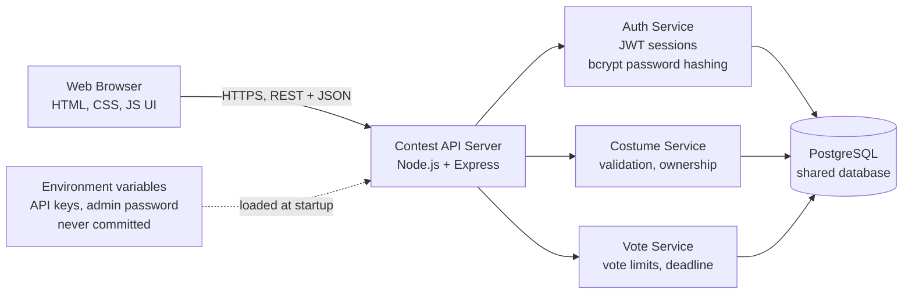

# Architecture: Fright Night Costume Contest

## Overview

The app uses a classic three-tier architecture. The browser is a thin client. All business rules (who can vote, vote limits, ownership) are enforced on the server, because **the client is never trusted**.

## Components

| Component | Responsibility |
|---|---|
| **Web Browser** | Renders pages and sends user actions to the API. Holds no data of its own except a session token. |
| **Contest API Server** | Single entry point for all requests. Routes them to the correct service. |
| **Auth Service** | Registers users, hashes passwords with bcrypt, issues and validates JWT session tokens. |
| **Costume Service** | Validates costume input, saves costumes, and enforces that only owners can delete. |
| **Vote Service** | Enforces every voting rule: login required, 3-vote limit, no self-voting, no duplicate votes, and the deadline. |
| **PostgreSQL** | One shared database for all guests. Everyone at the party sees the same costumes and live vote counts. |
| **Environment variables** | Store secrets outside the codebase. |

## Key Design Decisions

1. **Server-side validation.** Every rule is checked on the server, even if the UI also checks it.
2. **Shared state.** All guests read from and write to the same database.
3. **No secrets in code.** Keys and passwords live in environment variables only.
4. **Passwords are hashed.** Plain-text passwords never touch the database.
