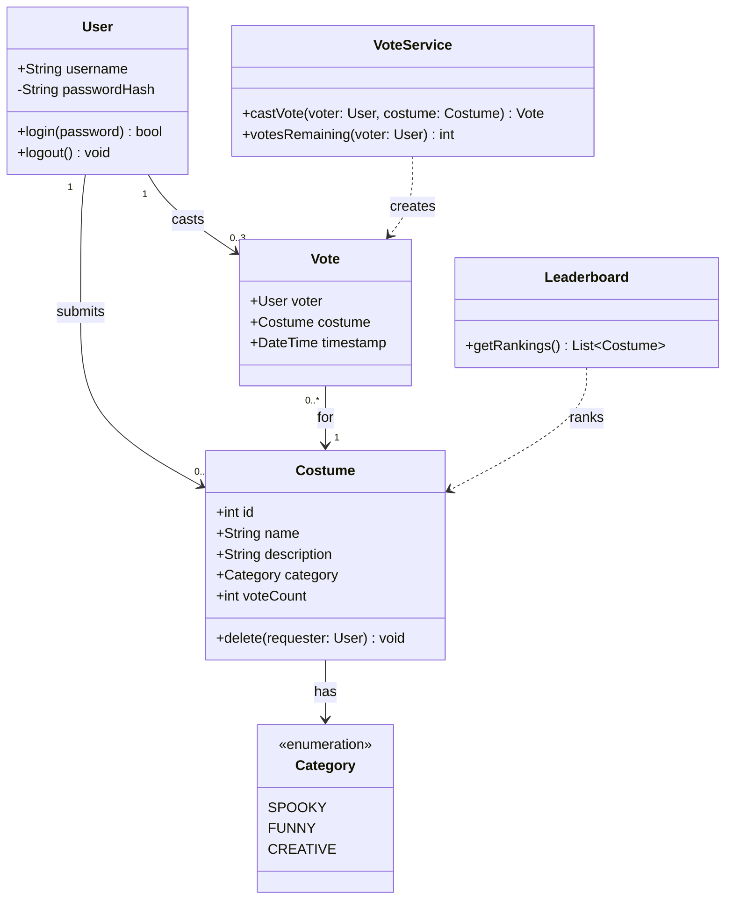

# UML Class Diagram: Fright Night Costume Contest

## Notes on the Design

| Element | Notes |
|---|---|
| `User.passwordHash` | Only the hash is stored, never the password itself. |
| `Costume.voteCount` | Always an integer. Starts at 0. |
| `Costume.delete(requester)` | Throws an error if `requester` is not the costume's owner. |
| `VoteService.castVote()` | Rejects the vote if the voter is not logged in, has no votes left, owns the costume, or already voted for it. |
| `Leaderboard.getRankings()` | Returns costumes sorted by `voteCount`, **highest first**. |
| `User` to `Vote` | A user can cast between 0 and 3 votes. |
