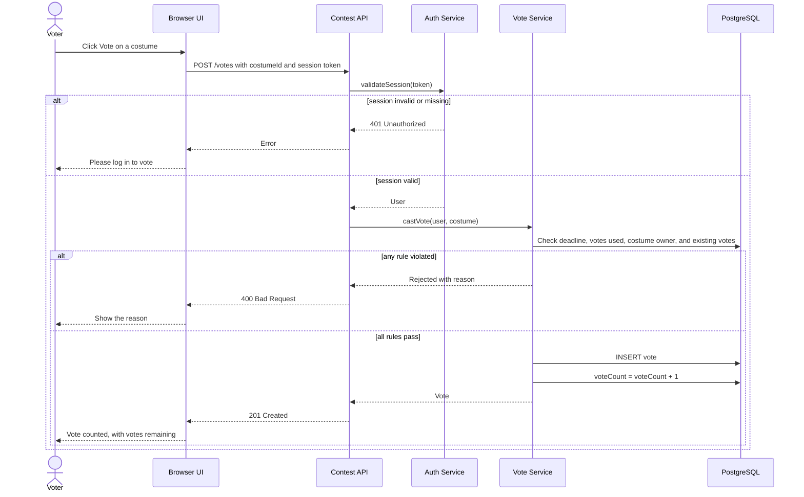

# UML Sequence Diagram: Casting a Vote

This diagram shows what happens when a guest clicks **Vote** on a costume.

## Rules Checked by the Vote Service

1. Voting has not closed (REQ-13)
2. The voter has used fewer than 3 votes (REQ-09)
3. The voter does not own the costume (REQ-10)
4. The voter has not already voted for this costume (REQ-11)
